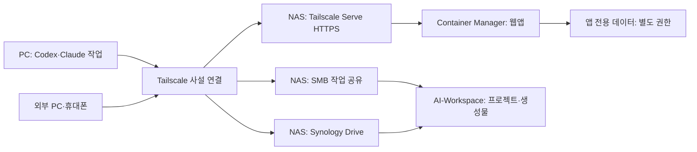

# DS225+ 원격 접속·Docker 개인 클라우드 구성안

> 최신 실행 상태는 [README.md](README.md)를 확인하세요. 2026-10-13 PC의 WSL Docker 설치와 두 컨테이너 실행·검증이 완료되었습니다. 아래 문서는 앞선 사전 점검·설계 기록이며, NAS 실기와 인터넷 공개는 아직 미실행입니다.

기준일: 2026-10-13 / 상태: 장비 도착 전 사전 준비 / 실제 배포: 미실행

> 요구사항 확정: 개인 파일 클라우드와 Docker 개발 서버를 함께 사용하며 공개 웹사이트도 운영한다. 이 문서는 비공개 기반 구성이고, 공개 서비스의 최신 기준은 `NAS-공개웹-운영설계.md` 및 `cloud/public/`을 함께 적용한다.

## 목적과 가정

DS225+를 AI 산출물 저장소, 외부에서 접근하는 개인 파일 클라우드, 경량 Docker 서비스 실행 서버로 사용한다. 본인과 지정 사용자만 접근하는 관리·파일 영역에 더해 공개 웹사이트 운영이 확정되었다. 공개 도메인, 실제 사용할 앱, 사용자 수, HDD 수량과 메모리 증설 여부는 미확정이다.

작업 규모 M, 설계 위험도 Medium. 요구사항·영향분석 → 구조 설계 → 사전 보안 검토 → 최소 시험 구성 → 정적 검증을 적용한다. NAS 운영 반영과 외부 공개는 이번에 실행하지 않는다.

## 하드웨어 사실과 적용 판단

| 항목 | 공식 확인 내용 | 설계에 적용할 판단 |
|---|---|---|
| CPU | Intel Celeron J4125, 4코어 | 소규모 웹앱·자동화 서비스를 단계적으로 시험 |
| 메모리 | 기본 2GB, 공식 최대 6GB(2GB+4GB) | 기본 상태에서 여러 앱·DB를 동시에 올리지 않고 실제 사용량 측정 |
| 저장소 | 2베이, 사용자 주문 HDD는 HAT3320-20T 20TB | HDD 수량 확인 후 보호·백업 구성 결정 |
| 컨테이너 | DS225+가 Container Manager 지원 모델에 포함 | DSM 패키지로 Docker 프로젝트 관리 |

경량 서비스 운용 가능성은 공식 지원에 기반한 설계 판단이며 성능 보장은 아니다. 대형 LLM 추론·학습과 무거운 빌드는 별도 PC/GPU/외부 연산 환경으로 두고 NAS는 저장과 경량 서비스를 담당하도록 권고한다. 메모리 증설 구매는 실행하지 않았다.

근거: [DS225+ 사양](https://www.synology.com/en-us/products/DS225%2B), [Container Manager 지원 모델](https://www.synology.com/en-in/dsm/packages/ContainerManager).

## 서비스 배치

| 영역 | 1차 구성 | 역할 | 상태 |
|---|---|---|---|
| 원격 접속 | PC·NAS의 Tailscale | 허용된 장치·사용자의 사설 접근 | PC 설치 파일 준비, 설치 완료 미확인 |
| AI 작업 폴더 | SMB 공유 AI-Workspace → PC W: | Codex·Claude 도구의 직접 파일 저장 | 연결 스크립트 준비 |
| 개인 파일 클라우드 | Synology Drive Server | 브라우저·앱 접근, 필요한 동기화·버전 기능 | NAS 도착 후 설정 |
| Docker 기반 | Container Manager Project | 경량 웹앱·자동화 서비스 실행 | 접속 점검용 Compose 준비 |
| 웹앱 원격 접근 | Tailscale Serve HTTPS | 허용된 사설망 사용자에게 웹서비스 제공 | NAS에서 지원·실동작 확인 필요 |
| 복구 | 휴지통·스냅샷·별도 백업 | 오삭제와 장애 복구 | 디스크·백업 대상 확인 후 결정 |

파일 클라우드는 Synology 기본 기능부터 사용하고, Docker는 추가 앱에 배치하는 것을 기본안으로 한다. Nextcloud 같은 별도 파일 클라우드는 필요한 기능이 Synology Drive로 충족되지 않을 때 비교한다. 자동화 도구, Git 서비스, 데이터베이스는 목적이 정해진 뒤 각 앱의 공식 사양·라이선스·백업 방법을 확인해서 추가한다.



위 그림은 목표 구조이다. 현재 제공한 접속 점검 컨테이너는 데이터 경로를 마운트하지 않고 응답만 반환한다. 이후 실제 앱마다 필요한 폴더만 추가하며 AI-Workspace 전체를 모든 컨테이너에 노출하지 않는다.

## 지금 준비한 Docker 프로젝트

`cloud/docker-compose.yml`과 `cloud/nginx.conf`는 컨테이너 시작, 상태 확인, 사설 HTTPS 경로를 검증하기 위한 단일 서비스이다. 실제 개인 클라우드 파일 서비스가 이미 만들어졌다는 의미는 아니다.

- 공식 NGINX unprivileged 이미지의 확인된 digest 고정. Linux/amd64 이미지 존재 및 기본 UID 101 확인.
- 호스트의 `127.0.0.1:18080`에만 게시하도록 설정. 인터넷 포트포워딩 없음.
- 컨테이너 UID/GID 101, 루트 파일시스템 읽기 전용, capability 제거.
- 비밀번호, API 키, 작업 파일, Docker 소켓을 마운트하지 않음.
- 점검 서비스의 메모리 상한 128MB, CPU 상한 0.5코어, 로그 회전 설정. 이는 설계값이며 실측 사용량이 아님.
- `/healthz`가 정상 JSON을 반환하도록 구성. 런타임 응답은 아직 검증하지 않음.

이미지와 스키마 출처·해시는 `cloud/validation/sources.json`, 정적 검증 결과는 `cloud/validation/result.json`에 기록한다. digest 고정은 업데이트가 자동 반영되지 않으므로 도착 후 배포 전에 보안 업데이트를 재확인한다. 취약점 스캔은 미실행이다.

## 실제 적용 전에 확인할 사항

Docker 공식 문서는 **Engine 28.0.0 이전 버전에서 같은 L2 네트워크의 다른 장치가 localhost 게시 포트에 접근할 수 있는 예외**를 명시한다. 따라서 Synology에서 실행되는 실제 Engine 버전·수정 반영 여부를 확인하고, `127.0.0.1` 설정만으로 접근 차단이 완료됐다고 판정하지 않는다. [Docker 포트 게시 문서](https://docs.docker.com/engine/network/port-publishing/)

처음에는 민감한 데이터가 없는 이 점검 서비스만 시험한다. 최신 지원 패키지, NAS 네트워크 보호, 비허용 장치 차단을 실제 확인하기 전에는 비밀번호나 작업 자료를 취급하는 앱을 배포하지 않는다. DSM 방화벽과 Docker 포트 처리 관계도 실측한다.

사용 PC의 방화벽 프로필별 보호 상태를 확인하고 보완한다. Tailscale 설치와 Windows 방화벽 설정은 각각 확인해야 한다.

## 장비 도착 후 순서

1. HDD 수량·메모리를 확인하고 DSM·스토리지·업데이트·계정을 설정한다. 데이터가 있는 디스크의 초기화는 별도 확인한다.
2. 관리 계정과 작업 계정을 분리하고 AI-Workspace 공유를 구성한다. W: 연결과 작은 파일 저장·복원을 검증한다.
3. PC·NAS의 Tailscale 로그인과 허용 사용자·장치 정책을 설정한다. 일반 파일 공유는 TCP 445, DSM 관리는 실제 설정 포트(기본 HTTPS 5001) 기준으로 필요한 사용자만 허용한다.
4. 필요한 경우 Synology Drive Server를 설치하고 AI-Workspace를 Team Folder로 설정한다. 직접 SMB 수정과 Drive 반영·버전 동작을 소량 파일로 시험한다.
5. Container Manager를 설치하고 실제 Docker Engine·Compose 버전과 사용 가능한 메모리를 확인한다.
6. NAS의 앱 전용 공유 아래 `docker/cloud-probe` 폴더에 `docker-compose.yml`, `nginx.conf`를 복사한다. 이 경로는 예시이며 실제 볼륨 번호를 확인한다. 컨테이너 UID 101이 설정 파일을 읽을 수 있도록 필요한 경로와 ACL만 확인하며 공유 전체를 777 권한으로 바꾸지 않는다.
7. Container Manager → 프로젝트 → 생성에서 해당 경로와 Compose 파일을 지정한다. 설정·이미지를 검토한 뒤 시작한다. 이 작업은 이번에 실행하지 않았다.
8. 내부에서 상태 확인 후 Tailscale Serve를 구성하고, 외부망의 허용 장치와 비허용 장치에서 접근을 각각 시험한다.
9. 실제 사용할 앱 하나를 선택하고 데이터 볼륨·인증·백업·자원 제한을 설계한 뒤 별도 프로젝트로 추가한다.

[Synology 프로젝트 관리](https://kb.synology.com/en-global/DSM/help/ContainerManager/docker_project)는 Compose 기반 프로젝트 생성과 시작·중지를 지원한다. GUI의 Clean/Delete 작업은 컨테이너와 관련 데이터에 영향을 줄 수 있으므로 단순 중지와 구분한다.

## 점검 명령 예시 — NAS에서만, 현재 미실행

SSH는 초기 관리에 필요한 기간만 사용하고, NAS의 승인된 관리자 세션에서 실행한다. 아래 명령은 작업 경로·버전·기존 설정을 확인한 후 사용하는 예시다.

```sh
docker version
docker compose version
docker compose -f docker-compose.yml config --quiet
docker compose -f docker-compose.yml ps
docker compose -f docker-compose.yml exec cloud-probe nginx -t
curl --fail http://127.0.0.1:18080/healthz
```

설치 버전에 따라 `docker-compose` 명령을 사용해야 할 수 있다. 실제 지원 명령으로 조정한다. Container Manager 권한과 SSH 접근 여부도 도착 후 확인한다.

Tailscale Serve는 먼저 기존 구성을 조회하고, 충돌이 없을 때 이 점검 서비스에 대한 사설 HTTPS 경로를 추가한다. 다음 명령도 현재 실행하지 않았다.

```sh
tailscale serve status
tailscale serve --bg http://127.0.0.1:18080
tailscale serve status
```

HTTPS 활성화가 필요하면 본인 계정으로 공식 동의 절차를 진행한다. 접근은 tailnet 정책을 따르므로 단순히 tailnet에 들어왔다는 이유로 모든 사용자에게 관리 권한을 주지 않는다. 공개 인터넷용 Funnel은 이 기본안에 포함하지 않는다. 기존 Serve가 있으면 덮어쓰지 않고 경로·포트를 다시 설계한다. [Tailscale Serve](https://tailscale.com/docs/features/tailscale-serve), [Serve 예시](https://tailscale.com/docs/reference/examples/serve)

## 수용기준과 복구

| ID | 검증 기준 | 현재 상태 |
|---|---|---|
| C1 | Compose 스키마 및 공개 포트·특권·소켓 마운트 방지 정적 검사 | 7개 점검 통과, 결과 JSON 기록 |
| C2 | NAS에서 컨테이너 Healthy, nginx -t 성공, healthz HTTP 200 | 미검증 |
| C3 | 외부망의 허용된 장치에서 HTTPS 정상 접근 | 미검증 |
| C4 | 비허용 tailnet 사용자·일반 LAN 장치의 앱 포트 접근 차단 | 미검증 |
| C5 | 인터넷에 DSM·SMB·DB 관리 포트가 노출되지 않음 | 미검증 |
| C6 | 컨테이너 재시작 후 정상 동작, 실제 앱 데이터 보존 | 미검증 |
| C7 | 대표 부하 30분에서 OOM·반복 재시작 없음, 메모리·응답시간 기록 | 미검증 |
| C8 | 작업 파일 및 실제 앱의 백업을 별도 위치로 복구 | 미검증 |

점검 서비스 중지는 Container Manager의 Stop을 우선한다. 서비스를 제거할 때도 데이터 볼륨 삭제를 자동 수행하지 않는다. Serve를 추가했다면 사전에 기록한 기존 설정과 비교하여 이번에 추가한 경로만 해제한다. 앱 업데이트는 고정 이미지·설정·데이터 백업을 남기고 한 프로젝트씩 수행한다.

판정: 사전 구성안·설정 파일 준비 단계. 운영 준비 완료 또는 배포 완료가 아니다. 독립 평가위원 검토, 컨테이너 런타임 테스트, 외부 접속·복구 테스트는 미수행이다.

## 검증 실행 및 출처

PC에서는 Docker를 설치하지 않고 기존 Python의 PyYAML·jsonschema를 사용해 다음 정적 검사만 실행한다.

```powershell
python .\cloud\validate_config.py
```

- [Synology Drive 기능](https://www.synology.com/en-us/dsm/feature/drive)
- [Tailscale의 Synology 지원](https://tailscale.com/docs/integrations/synology)
- [Docker Compose 서비스 정의](https://docs.docker.com/reference/compose-file/services/)
- [NGINX unprivileged 공식 프로젝트](https://github.com/nginx/docker-nginx-unprivileged)
- [Compose 공식 스키마](https://github.com/compose-spec/compose-spec/blob/master/schema/compose-spec.json)
