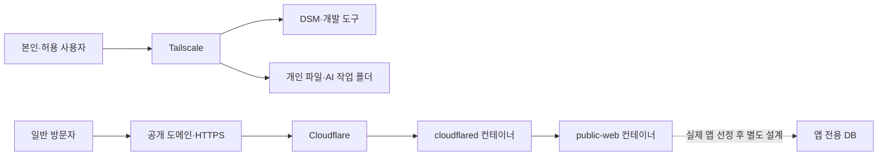

# DS225+ 개인 클라우드·개발 서버·공개 웹사이트 설계

> 최신 실행 상태는 [README.md](README.md)를 확인하세요. 2026-10-13 PC의 WSL Docker 설치와 두 컨테이너 실행·검증이 완료되었습니다. 아래 문서는 앞선 사전 점검·설계 기록이며, NAS 실기와 인터넷 공개는 아직 미실행입니다.

기준일: 2026-10-13 / 장비: 배송 전 / 상태: 사전 구성 초안, 실제 공개 미실행

## 확정된 요구사항과 현재 범위

사용자는 개인 파일 클라우드와 Docker 개발 서버를 함께 사용하며, 누구나 접속할 수 있는 공개 웹사이트도 운영한다. 이 문서는 기존 개인 클라우드 설계에 공개 영역을 추가한 최신 기준이다.

공개 도메인, 처음 공개할 앱의 종류, 사용자·트래픽 규모, 로그인·DB 필요 여부는 미확정이다. 도메인 구매·이전, DNS 변경, 계정 생성, 터널 생성, NAS 배포는 실행하지 않았다. 현재 준비물은 접속 구조, 점검용 Compose, 공개 경로 예시와 정적 검증이다.

규모 M / 설계 위험도 High / 방법론: 영향분석 + 위협 검토 + 단계별 검증. 인터넷 공개 전에 실제 주소·콘텐츠·접근 시험 결과를 검토할 수 있는 상태로 만들고 운영 반영 승인을 받는다.

## 권고 구조

| 구역 | 대상 | 접속 경로 | 공개 여부 |
|---|---|---|---|
| NAS 관리 | DSM, Container Manager, 유지보수 | 허용 장치의 Tailscale | 비공개 |
| 개인 파일 | AI-Workspace, W: 드라이브, Synology Drive | Tailscale 및 필요한 앱 인증 | 비공개 |
| 개발·검토 | 개발 앱, 테스트 API, 자동화 관리 화면 | Tailscale, 앱별 인증 | 비공개 |
| 공개 사이트 | 지정한 웹앱·공개 콘텐츠 | 도메인 → Cloudflare Tunnel → 공개 웹 컨테이너 | 누구나 접근 |
| DB·비밀정보 | 앱 데이터, 인증키, 터널 토큰 | 앱별 내부 경로·권한 | 비공개 |



공개 Compose는 개인 파일·관리 서비스가 사용하는 Compose와 별도 프로젝트이다. 공개 웹 컨테이너는 전용 내부 네트워크에만 연결하고, NAS 호스트 포트를 게시하지 않는다. cloudflared만 외부 연결용 네트워크를 추가로 사용한다.

이것은 단일 NAS 안의 네트워크·권한 분리이며, 다른 물리 서버와 같은 격리 수준은 아니다. cloudflared의 외부 연결망에서는 NAS/LAN 방향 통신이 가능할 수 있으므로 실제 네트워크 정책을 검증해야 한다. 민감한 자료나 높은 가용성이 요구되면 공개 서비스를 별도 서버에 두는 대안도 재검토한다.

## 공개 접속 대안

| 방식 | 선행조건 | 장점 | 제약·판단 |
|---|---|---|---|
| Cloudflare Tunnel | Cloudflare 계정, Cloudflare에서 사용할 도메인, NAS 외부 연결 | 인바운드 포트포워딩 없이 지정 웹앱 공개 | 이번 설정 초안의 우선안. 도메인·계정 확정 후 적용 |
| Tailscale Funnel | Tailscale 설정·HTTPS·Funnel 허용 | 별도 도메인 준비 전 공개 시험 가능 | ts.net 주소와 고정된 포트·대역폭 제약. 현재 공개하지 않음 |
| DDNS + 역방향 프록시 | 외부 접근 가능한 회선, 라우터 설정, TLS·인증 관리 | 직접 제어 가능 | 공인 주소·CGNAT·보안 운영 부담 확인 필요. 초기 기본안에서 제외 |

Cloudflare 고정 공개 경로에는 도메인이 필요하다. 기존 도메인이 있으면 현재 DNS·메일·웹사이트 영향을 먼저 확인하고 필요한 변경을 정한다. 도메인 구매나 등록기관 이전이 반드시 필요하다고 가정하지 않는다. 비용·플랜 조건은 실제 서비스와 도메인을 정할 때 확인한다. [Cloudflare Tunnel 시작 요건](https://developers.cloudflare.com/tunnel/get-started/)

Cloudflare Tunnel은 NAS에서 외부로 연결하며, 터널 운용에는 일반적으로 TCP/UDP 7844 외부 연결이 필요하다. 사용자 웹 트래픽은 Cloudflare를 통과하므로 공개 서비스의 데이터 처리 경로에 포함해 판단한다. [공식 방화벽 안내](https://developers.cloudflare.com/cloudflare-one/networks/connectors/cloudflare-tunnel/configure-tunnels/tunnel-with-firewall/)

Funnel은 ts.net 도메인 및 대역폭 제약이 있고, 같은 포트에서 기존 Serve 구성을 공개로 바꿀 수 있으므로 관리용 Serve에 무심코 적용하지 않는다. [Tailscale Funnel 공식 안내](https://tailscale.com/docs/features/tailscale-funnel)

## 준비한 공개 프로젝트

경로: `cloud/public/`

- `docker-compose.yml`: 공개 웹 점검 컨테이너 + cloudflared의 두 서비스.
- `nginx.conf`: `/healthz`는 200, 나머지는 준비 중 안내와 503. 실제 사이트 콘텐츠는 아직 없음.
- `.env.example`: 실제 토큰 대신 NAS의 토큰 파일 경로만 지정하는 예시.
- `route-plan.example.json`: `www.example.com → http://public-web:8080`, 나머지 404의 검토용 초안.
- `validate_public.py`: 공개 경계와 Compose 스키마 검사. 외부 서비스에 접속하지 않음.
- `validation-sources.json`: 확인한 이미지 digest와 공식 근거.
- `validation-result.json`: 실행한 정적 검사 결과.

두 컨테이너는 비root 사용자, 읽기 전용 루트 파일시스템, capability 제거와 자원·로그 제한을 적용한다. 웹은 128MB, 터널은 256MB 메모리 상한을 둔 시험값이며 충분한 성능을 검증한 값은 아니다. 이미지 digest는 확인 시점에 고정했으며, 배포 전에 최신 보안 업데이트를 검토한다.

공개 프로젝트에는 `ports`, host 네트워크, Docker 소켓, AI-Workspace, 개인 Drive 저장소를 연결하지 않는다. 공개용 파일은 실제 앱을 정한 후 별도 공개 디렉터리로 배치한다. 개발 프로젝트 전체나 `.git`, `.env`, 백업 파일을 정적 웹 루트로 사용하지 않는다.

## 토큰과 원격 경로

현재 실제 Cloudflare 터널과 토큰은 없다. `--token-file`과 Docker Compose secret 파일을 사용하도록 초안만 작성했다. Cloudflare의 해당 옵션은 2025.4.0 이상에서 지원된다. [공식 실행 인수](https://developers.cloudflare.com/cloudflare-one/networks/connectors/cloudflare-tunnel/configure-tunnels/run-parameters/)

토큰은 NAS의 보호된 별도 경로에 보관하고 저장소·대화·명령 인수·환경변수 값에 기록하지 않는다. `.env`에는 **파일의 경로만** 넣는다. Compose의 파일 기반 secret은 호스트 파일을 마운트하는 방식으로, 파일 자체가 자동 암호화되는 저장소는 아니다. NAS 파일 권한으로 보호하고 cloudflared UID/GID 65532가 필요한 파일만 읽을 수 있도록 확인한다. 소스 파일의 소유권·권한은 실제 NAS에서 설정하며 전체 공유를 777로 변경하지 않는다. [Docker Compose secrets](https://docs.docker.com/compose/how-tos/use-secrets)

공개 경로는 Cloudflare 대시보드에서 관리한다. `route-plan.example.json`은 검토용 예시이며 컨테이너가 자동 적용하지 않는다. 도메인 확정 후 실제 공개 경로는 다음처럼 설정한다.

```text
공개 호스트명: www.<실제 도메인>
서비스: http://public-web:8080
그 외 경로: HTTP 404
```

컨테이너 안의 localhost는 NAS 호스트를 뜻하지 않는다. 위 서비스명은 두 컨테이너가 공유하는 Docker 네트워크의 이름 해석을 사용한다. NAS 주소의 5000/5001, 445, 개발용 관리자 화면, DB 포트를 공개 터널 대상에 넣지 않는다.

누구나 보는 사이트에는 방문자용 Tailscale 설치가 필요 없다. 로그인 웹앱이면 별도의 사용자 인증·권한·세션·업로드 검증이 필요하며 Tunnel 자체가 이를 대신하지 않는다. 관리자 페이지는 일반 방문자 경로와 구분한다.

## 도착 후 실행 순서와 수용기준

1. DSM·스토리지·계정·방화벽과 개인 클라우드를 먼저 구성하고 복구 시험을 수행한다.
2. 도메인·사이트 형태·공개 콘텐츠를 확정한다. 기존 DNS가 있으면 웹·메일 레코드 영향을 확인한다.
3. 공개 전용 NAS 디렉터리와 토큰 경로를 준비하고, Container Manager에서 공개 프로젝트 설정을 검토한다.
4. 실제 NAS에서 Compose 해석·이미지 실행·토큰 파일 읽기·리소스 제한을 검증한다. 공개 전에는 민감한 파일이 없는 시험 응답만 사용한다.
5. Cloudflare 계정과 터널·공개 호스트명 구성을 검토 가능한 상태로 준비한다. 실제 공개는 이 구성에 대한 최종 운영 반영 승인 후 실행한다.
6. 일반 인터넷 장치에서 공개 사이트만 접근되는지, NAS 관리·개인 파일·개발 도구는 접근되지 않는지 확인한다.
7. 사이트 로그·터널 연결·5xx 오류·메모리·재시작을 관찰하고 앱별 데이터 복구를 시험한다.

| ID | 확인할 내용 | 현재 상태 |
|---|---|---|
| P1 | Compose 스키마·호스트 포트 없음·개인 마운트 없음·토큰 분리 | 공개용 11개 통과, 기존 사설용 7개 회귀 점검 통과 |
| P2 | NAS에서 웹 Healthy, 터널 Connected | 미검증 |
| P3 | 일반 인터넷에서 올바른 도메인·TLS로 사이트 접속 | 미검증 |
| P4 | 미지정 호스트·개인 파일·DSM·DB·개발 도구의 공개 차단 | 미검증 |
| P5 | 로그인 앱의 인증·인가·입력·업로드 검증 | 앱 선정 후 |
| P6 | 앱과 DB 백업을 별도 위치에 복구 | 앱 선정 후 |
| P7 | 변경 전 이미지·설정으로 복귀 및 공개 중단 | 절차만 준비 |

공개 중단은 이번 터널의 cloudflared 컨테이너 정지를 우선하고, 필요한 경우 해당 공개 호스트 경로만 비활성화한다. 개인 Tailscale과 파일 서비스를 함께 내리지 않는다. 데이터 볼륨 삭제나 계정 삭제는 복구 절차에 포함하지 않는다. 터널 토큰이 노출되면 Cloudflare에서 해당 토큰을 교체하고 관련 컨테이너만 갱신한다.

## 검증 범위와 미완료

PC의 정적 검증 명령:

```powershell
python .\cloud\validate_config.py
python .\cloud\public\validate_public.py
```

이 검사는 YAML·Compose 구조와 초안의 경계 조건을 확인한다. 실제 Container Manager 호환성, 원격 Cloudflare 설정, NAS ACL, 런타임 격리·취약점·부하·백업 복원 검사는 대체하지 않는다.

판정: 공개 운영을 위한 설계·설정 초안 준비 단계. 운영 배포 후보 승인은 보류이며 실제 공개는 미실행이다. 별도 평가위원의 독립 검토도 수행하지 않았다.
